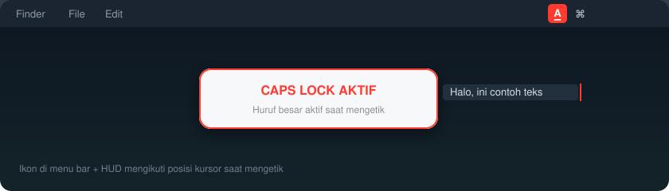

# CapLock

[](https://developer.apple.com/macos/)
[](https://en.wikipedia.org/wiki/X86-64)
[](https://swift.org/)
[](#kenapa-tanpa-izin)

Indikator **Caps Lock** untuk macOS Ventura ke atas yang tinggal duduk di menu bar dan
menampilkan notifikasi kecil dekat kursor saat status berubah. Cocok untuk keyboard yang
tidak punya lampu Caps Lock, atau kalau Anda sering mengetik dalam huruf besar tanpa sadar.



> Ikon default: tombol Caps Lock klasik dengan huruf **A**. Warna, gaya, dan ukuran bisa
> diubah lewat Settings.

## Fitur

- **Status real-time di menu bar** — ikon berubah warna saat Caps Lock aktif.
- **HUD dekat kursor** — notifikasi muncul di dekat tempat Anda mengetik, lalu hilang otomatis.
- **Tanpa izin Accessibility / Input Monitoring** — status dibaca dari HID system, bukan dari keystroke.
- **Settings lengkap**:
  - 3 gaya ikon: tombol klasik, huruf A saja, atau lingkaran
  - warna bebas untuk kondisi aktif dan nonaktif
  - ukuran ikon 14–24 pt
  - posisi HUD: dekat kursor atau tengah atas layar
  - lama tampil HUD 0,5–4 detik
  - suara on/off saat status berubah
  - jalankan otomatis saat login (macOS 13+)
- **Menu bar only** — tidak muncul di Dock, tidak memunculkan jendela saat start.
- Ringan: polling 120 ms, tanpa event tap, tanpa network.

## Install

### Cara cepat (prebuilt)

1. Download **[CapLock.zip](CapLock.zip)** dari repo ini, lalu unzip.
2. Tarik `CapLock.app` ke folder **Applications**.
3. Buka dari Applications / Launchpad.
4. Klik ikon di menu bar → **Settings…** untuk mengubah warna dan pengaturan lainnya.

Atau clone repo lalu pakai `CapLock.app` yang sudah ada di root:

```bash
git clone git@github.com:Syuhadak27/caplock.git
cp -R caplock/CapLock.app /Applications/
open /Applications/CapLock.app
```

Jika macOS menolak membuka aplikasi (karena di-build lokal, bukan dari App Store):

```bash
xattr -d com.apple.quarantine /Applications/CapLock.app
```

Atau klik kanan `CapLock.app` → **Open** → **Open** lagi.

### Build dari source

Butuh macOS 13+ dengan **Command Line Tools** (tidak perlu Xcode penuh):

```bash
xcode-select --install    # kalau belum ada
git clone git@github.com:Syuhadak27/caplock.git
cd caplock/CapLock
./build.sh                # hasil: CapLock/CapLock.app
```

Script `build.sh` melakukan kompilasi dengan `swiftc`, membuat bundle, menanam ikon, dan
memberi tanda tangan ad-hoc (`codesign --sign -`).

## Pakai

Klik ikon di menu bar untuk membuka menu:

```
Caps Lock: nonaktif
─────────────────────
Pratinjau notifikasi
Settings…
─────────────────────
Keluar CapLock
```

Saat Caps Lock ditekan, HUD berisi `CAPS LOCK AKTIF` / `CAPS LOCK NONAKTIF` muncul dekat
pointer mouse dan auto-hilang setelah durasi yang diatur.

## Kenapa tanpa izin?

Banyak indikator Caps Lock memasang *event tap* dan meminta **Input Monitoring**. CapLock
tidak melakukan itu. Ia sesekali memanggil `IOHIDGetModifierLockState` dari IOKit — sumber
status yang sama dengan lampu fisik Caps Lock — sehingga tidak perlu izin khusus dan tidak
membaca apa pun yang Anda ketik.

> Catatan: untuk keyboard dengan fitur “Caps Lock untuk ganti bahasa input”, macOS
> kadang melaporkan status sesaat saat tombol ditekan. CapLock memakai dua pembacaan
> berurutan (≈240 ms) supaya tidak berkedip.

## Struktur repo

```
.
├── CapLock.app          # aplikasi siap pakai (prebuilt)
├── CapLock.zip          # versi zip untuk download
├── CapLock/
│   ├── Sources/main.swift   # seluruh source aplikasi
│   ├── Resources/AppIcon.icns
│   └── build.sh             # build + bundle + codesign
└── README.md
```

## Kompatibilitas

| Item | Keterangan |
|---|---|
| macOS | 13.0 Ventura ke atas (diuji di 13.7.8) |
| CPU | Intel x86_64 (di Apple Silicon bisa jalan via Rosetta 2) |
| Swift | 5.8+ |
| Izin | Tidak ada |

## Uninstall

1. Klik ikon menu bar → **Keluar CapLock**.
2. Hapus `CapLock.app` dari Applications.
3. Kalau auto-start aktif, hapus dari **System Settings → General → Login Items & Extensions**.

## Troubleshooting

| Masalah | Solusi |
|---|---|
| Ikon tidak muncul | Pastikan app berjalan (`pgrep -fl CapLock`); keluar lalu buka lagi |
| “App cannot be opened” | `xattr -d com.apple.quarantine /Applications/CapLock.app` |
| Auto-start gagal aktif | Pindahkan app ke `/Applications` dulu, lalu aktifkan lagi di Settings |
| Status terasa telat | Durasi debounce ≈240 ms sengaja dipakai untuk menghindari kedip |

---

Dibuat dengan Swift + AppKit + SwiftUI + IOKit.
